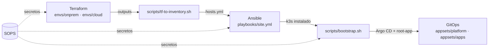
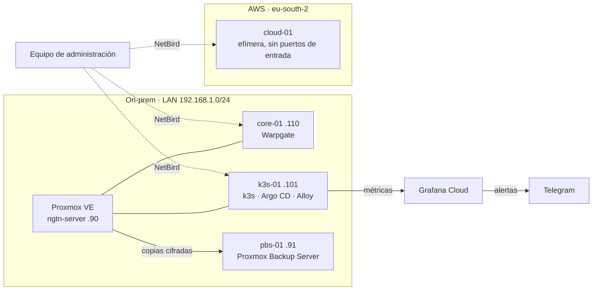

# Arquitectura general

↑ [Mapa del repositorio](README.md)

La plataforma combina un entorno **on-premise** (hipervisor Proxmox) y un entorno **cloud** (AWS),
gestionados de forma declarativa en tres capas: provisión con Terraform, configuración con Ansible y
entrega de aplicaciones con GitOps (Argo CD). Una VPN en malla (NetBird) une los dos entornos.

> [!NOTE]
> **Estado (2026-10-13):** implementados y verificados el entorno on-prem (pruebas de
> reconstrucción), el entorno cloud efímero en AWS, la VPN en malla, la monitorización y las copias
> de seguridad con restauración probada. Los elementos marcados como *(previsto)* forman parte del
> diseño, pero aún no están desplegados.

## Flujo de despliegue

`make deploy` ejecuta la cadena completa en on-prem; `make deploy ENV=cloud`, la del entorno cloud
(sin GitOps).

## Topología

## 1. Provisión: Terraform

Decisión: [0002-terraform-ansible-separacion](adr/0002-terraform-ansible-separacion.md)

| Elemento | Función | Código |
|---|---|---|
| Entorno on-prem | VMs en Proxmox para nodos `core` y `k3s` | [envs/onprem/main.tf](../terraform/envs/onprem/main.tf) |
| Entorno cloud | Red (VPC, subred, security group sin entrada) y VM `cloud-01` en AWS; se crea y se destruye entero | [envs/cloud/main.tf](../terraform/envs/cloud/main.tf) |
| Módulo `proxmox-image` | Plantilla base (imagen cloud-init) | [modules/proxmox-image/](../terraform/modules/proxmox-image/main.tf) |
| Módulo `proxmox-vm` | VM reutilizable en Proxmox | [modules/proxmox-vm/](../terraform/modules/proxmox-vm/main.tf) |
| Módulo `cloud-vm` | VM reutilizable en AWS (IMDSv2, disco cifrado) | [modules/cloud-vm/](../terraform/modules/cloud-vm/main.tf) |
| Estado | Local en el equipo de administración; backend remoto *(previsto)* | [onprem/backend.tf](../terraform/envs/onprem/backend.tf), [cloud/backend.tf](../terraform/envs/cloud/backend.tf) |
| Credenciales | On-prem: `.env` (fuera del repositorio). Cloud: SSO de AWS (perfil `tfg`) y setup key de NetBird desde SOPS por `TF_VAR_` | [0006-aws-credenciales-sso](adr/0006-aws-credenciales-sso.md) |

Los `outputs.tf` de cada entorno exponen los datos de los hosts (nombre, IP o nombre en la malla,
grupo) que consume la capa de configuración.

## Plan de IPs y redes

On-prem: red `192.168.1.0/24`, puerta de enlace `192.168.1.1`.

| Dirección o rango | Uso | Asignadas |
|---|---|---|
| `.90` | Nodo Proxmox VE `ngtn-server` (8 GB de RAM) | — |
| `.91` | Proxmox Backup Server `pbs-01` (portátil, 8 GB, HDD de 1 TB) | — |
| `.100` | Reservada (futura VIP o API del clúster) | — |
| `.101–.109` | Nodos k3s | `k3s-01` (`.101`, 2 vCPU, 4 GB) |
| `.110–.114` | Servicios core | `core-01` (`.110`, 1 vCPU, 512 MB) |
| `.115–.119` | Reserva (pruebas) | — |

Las IPs de las VMs se fijan en [terraform.tfvars](../terraform/envs/onprem/terraform.tfvars).
`core-01` tiene 512 MB porque el nodo solo tenía ~1,3 GiB libres con `k3s-01` en marcha; Warpgate
consume unos 43 MiB.

Otras redes:

- **Cloud (AWS):** VPC `10.20.0.0/16`, subred pública `10.20.1.0/24` (sin NAT gateway).
- **Malla NetBird:** cada equipo recibe una IP `100.x` y un nombre `<equipo>.netbird.cloud`. Grupos
  `admin`, `onprem` y `cloud`; denegación por defecto y políticas `admin-a-onprem` (TCP 22, 80, 443,
  2222, 6443, 8888) y `admin-a-cloud` (TCP 22).

## 2. Puente Terraform → Ansible

[scripts/tf-to-inventory.sh](../scripts/tf-to-inventory.sh) transforma `terraform output` en los
inventarios de Ansible:

- `terraform/envs/onprem` → [inventories/onprem/hosts.yml](../ansible/inventories/onprem/hosts.yml) (IPs de la LAN)
- `terraform/envs/cloud` → [inventories/cloud/hosts.yml](../ansible/inventories/cloud/hosts.yml) (nombres en la malla NetBird)

De este modo la fuente de verdad del inventario es Terraform y se evita mantener IPs a mano.

## 3. Configuración: Ansible

Decisiones: [0002-terraform-ansible-separacion](adr/0002-terraform-ansible-separacion.md), [0001-eleccion-k3s](adr/0001-eleccion-k3s.md)

| Playbook | Alcance | Roles |
|---|---|---|
| [site.yml](../ansible/playbooks/site.yml) | Orquesta los demás playbooks | — |
| [base.yml](../ansible/playbooks/base.yml) | Todos los hosts | `common`, `hardening`, `node_exporter` |
| [netbird.yml](../ansible/playbooks/netbird.yml) | Todos los hosts + `localhost` (API de NetBird) | `netbird` |
| [k3s.yml](../ansible/playbooks/k3s.yml) | Grupo `k3s` ([group_vars](../ansible/inventories/onprem/group_vars/k3s.yml)) | `k3s` |
| [core.yml](../ansible/playbooks/core.yml) | Grupo `core` ([group_vars](../ansible/inventories/onprem/group_vars/core.yml)) y resto de VMs on-prem (clave de Warpgate) | `warpgate` (previstos: `docker`, `authentik`) |

El mismo `site.yml` sirve para los dos entornos; las diferencias van en las variables de cada
inventario (por ejemplo, `common_qemu_guest_agent: false` en cloud).

Servicios de la capa *core* y de acceso:

- **NetBird** (implementado, fase 1): VPN en malla (WireGuard) con el plano de control en NetBird
  Cloud; cliente en todas las VMs y grupos y políticas por API. Ver [acceso-vpn](runbooks/acceso-vpn.md)
  y [0005-vpn-netbird](adr/0005-vpn-netbird.md).
- **Warpgate** (implementado en `core-01`): bastión SSH con control de acceso por roles, doble factor
  (clave pública + TOTP) y grabación de sesiones. Es el acceso SSH humano a las VMs **on-prem**;
  usuarios, roles, destinos y huellas se declaran en
  [group_vars/core.yml](../ansible/inventories/onprem/group_vars/core.yml) y se aplican con su API.
  Ver [acceso-warpgate](runbooks/acceso-warpgate.md).
- **Entorno cloud en AWS** (implementado, `eu-south-2`): VMs efímeras sin puertos de entrada que se
  unen a NetBird en el primer arranque (cloud-init) y se configuran con el mismo `site.yml` por la
  VPN; se administran por SSH a través de NetBird, no de Warpgate. Ver [vm-cloud](runbooks/vm-cloud.md)
  y [0007-vm-cloud-sin-puertos-entrada](adr/0007-vm-cloud-sin-puertos-entrada.md).
- **Authentik** *(previsto)*: proveedor de identidad (SSO) para los servicios de la plataforma.

Configuración común: [ansible.cfg](../ansible/ansible.cfg), colecciones en [requirements.yml](../ansible/requirements.yml).

## 4. Entrega continua: GitOps

Decisión: [0003-gitops-argocd](adr/0003-gitops-argocd.md)

`scripts/bootstrap.sh` instala Argo CD y aplica la aplicación raíz; desde ese momento Argo CD se
gestiona a sí mismo y despliega el resto desde la rama `main`:

- [platform.yaml](../gitops/appsets/platform.yaml): `Application` (patrón *App of Apps*) que recoge
  el `application.yaml` de cada carpeta de `gitops/platform/`.
- [apps.yaml](../gitops/appsets/apps.yaml): `ApplicationSet` que crea una `Application` por cada
  carpeta de `gitops/apps/` (añadir una carpeta = desplegar una aplicación).

| Aplicación | Ruta | Depende de |
|---|---|---|
| Argo CD | [bootstrap/argocd/](../gitops/bootstrap/argocd/kustomization.yaml) | Clúster k3s ([0001-eleccion-k3s](adr/0001-eleccion-k3s.md)) |
| Root app | [bootstrap/root-app.yaml](../gitops/bootstrap/root-app.yaml) | Argo CD |
| Traefik | `gitops/platform/traefik/` | k3s (Traefik integrado desactivado, ver [0001-eleccion-k3s](adr/0001-eleccion-k3s.md)) |
| Grafana Alloy | `gitops/platform/monitoring/` | Rol `node_exporter` en las VMs; Secret `grafana-cloud` (bootstrap) |
| cert-manager *(previsto)* | `gitops/platform/cert-manager/` | Traefik (TLS de los Ingress) |
| demo-app | [apps/demo-app/](../gitops/apps/demo-app/deployment.yaml) | Traefik (Ingress) |

Descartado: **Velero** (copias de Kubernetes), porque el estado del clúster está en Git y las VMs se
copian enteras con PBS ([0009-copias-pbs](adr/0009-copias-pbs.md)).

## 5. Secretos

Decisión: [0004-gestion-secretos-sops](adr/0004-gestion-secretos-sops.md): reglas en [.sops.yaml](../.sops.yaml); ficheros cifrados en [secrets/](../secrets/).

- Solo se cifran los valores, así que los cambios se pueden revisar en Git.
- Se descifran en el equipo de administración: Ansible con el lookup `community.sops.sops`,
  Terraform por `TF_VAR_` (Makefile) y `bootstrap.sh` con `sops decrypt`.

| Fichero | Contenido | Lo usa |
|---|---|---|
| `warpgate.sops.yaml` | Contraseña de admin y TOTP de Warpgate | Ansible (rol `warpgate`) |
| `argocd.sops.yaml` | Hash de la contraseña de admin de Argo CD | `bootstrap.sh` |
| `netbird.sops.yaml` | Setup keys (on-prem y cloud) y token de la API | Ansible (rol `netbird`), Terraform (cloud) |
| `grafana-cloud.sops.yaml` | Token de envío de métricas (`metrics:write`) | `bootstrap.sh` (Secret `grafana-cloud`) |
| `pbs.sops.yaml` | Token de PBS para Proxmox VE y clave de cifrado de las copias | Configuración manual en Proxmox VE (copia de seguridad de los secretos) |

## 6. Observabilidad

Decisión: [0008-monitorizacion-grafana-cloud](adr/0008-monitorizacion-grafana-cloud.md)

- `node_exporter` en cada VM (puerto 9100 abierto solo a los nodos k3s).
- Un único **Grafana Alloy** en el clúster recoge las métricas y las envía a **Grafana Cloud**.
- Panel *Node Exporter Full* y alerta "VM sin métricas" (incluye la falta de datos) por **Telegram**.
- *(Futuro)* Logs con el mismo Alloy hacia Grafana Cloud (Loki gestionado), sin Loki en el clúster.

Ver [monitorizacion](runbooks/monitorizacion.md).

## 7. Copias de seguridad

Decisión: [0009-copias-pbs](adr/0009-copias-pbs.md)

Dos estrategias de recuperación complementarias:

| Estrategia | Recupera | Tiempo medido |
|---|---|---|
| Reconstruir desde código (`make rebuild`, `apply -replace`) | Configuración (sin datos) | `core-01`: 47 s; plataforma completa: 6 min 33 s |
| Restaurar desde Proxmox Backup Server | Datos y estado exacto de la VM | `core-01`: 1 min 19 s |

- **PBS** en un equipo aparte (`pbs-01`), datastore `backup-tfg`.
- Copia diaria de `core-01` y `k3s-01` (21:00, modo *snapshot*), **cifrada en el origen**.
- Token de mínimo privilegio (solo `Datastore.Backup`: no puede borrar copias).
- Retención (3 últimas + 7 diarias), limpieza diaria y verificación (cada copia, como mucho una vez al mes).
- Lo que no se reconstruye desde Git: datos de Warpgate (base de datos y grabaciones) y estado de
  Terraform (pendiente: backend remoto).

Ver [backups](runbooks/backups.md).

## CI y seguridad

| Workflow | Función | Estado |
|---|---|---|
| [terraform.yml](../.github/workflows/terraform.yml) | `fmt -check` y `validate`, sin credenciales | ✅ En cada PR que toca `terraform/` |
| [ansible.yml](../.github/workflows/ansible.yml) | `ansible-lint` (incluye `syntax-check`) | ✅ En cada PR que toca `ansible/` |
| [security.yml](../.github/workflows/security.yml) | gitleaks sobre todo el historial y hooks de pre-commit | ✅ Obligatorio para fusionar en `main` |

Validaciones locales con [.pre-commit-config.yaml](../.pre-commit-config.yaml).

## Procedimientos relacionados

- Puesta en marcha: [configuracion-inicial](runbooks/configuracion-inicial.md), [puesta-en-marcha](runbooks/puesta-en-marcha.md), [añadir-nodo](runbooks/añadir-nodo.md)
- Acceso: [acceso-warpgate](runbooks/acceso-warpgate.md), [acceso-vpn](runbooks/acceso-vpn.md)
- Entorno cloud: [vm-cloud](runbooks/vm-cloud.md)
- Operación: [monitorizacion](runbooks/monitorizacion.md), [backups](runbooks/backups.md), [restauracion](runbooks/restauracion.md)
